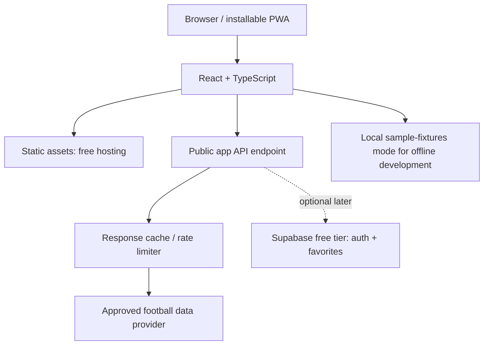

# Proposed technical architecture (ADR candidate)

Status: proposed, not yet deployed.

## MVP stack
React + TypeScript + Vite + Tailwind CSS client (all open source), static hosting on Cloudflare Pages free plan or GitHub Pages, Vitest and Playwright for tests. A minimal serverless proxy is **optional and requires separate free-tier verification** before use. A third-party football API token **must never** be bundled into the frontend.

## Data contracts (proposed)
`Competition {id, name, season, source}`
`Match {id, competitionId, kickoffUtc, homeTeam, awayTeam, status, homeScore?, awayScore?, sourceUpdatedAt?, fetchedAt, dataMode}`
`StandingsRow {competitionId, season, rank, team, played?, won?, drawn?, lost?, points?, goalDifference?}`
`ApiError {code, message, retryable, retryAfterSeconds?}`
All display times derive from UTC; scores may be null. `dataMode` is `provider` or `sample`. React UI must surface it visibly.

## Endpoints (proposed, not implemented)
`GET /api/competitions`
`GET /api/matches?date=YYYY-MM-DD&competitionId=...`
`GET /api/matches/:id`
`GET /api/standings?competitionId=...&season=...`
The adapter normalizes third-party formats, strips secrets, validates responses, applies caching and responds with clear 429/5xx errors.

## Cache strategy
Use conservative TTL per endpoint, respect provider terms and rate limits, apply request coalescing and bounded retries with backoff. Never suggest fresh live data when cache is old. If no compliant free server-side service can sustain requested traffic, ship demo-only or slower-update modes without paid upgrades.

## Evolution
Phase 1: documentation and static mock UI.
Phase 2: rate-limited compliant backend adapter with verified zero-cost deployment.
Phase 3: PWA and optional Supabase Auth/favorites only after privacy, RLS and inactivity behavior are tested.

## Design principles
Least privilege; provider abstraction; no direct token exposure; graceful degradation; accessible responsive components; testability with fixtures; no scraping; no fabricated data.
